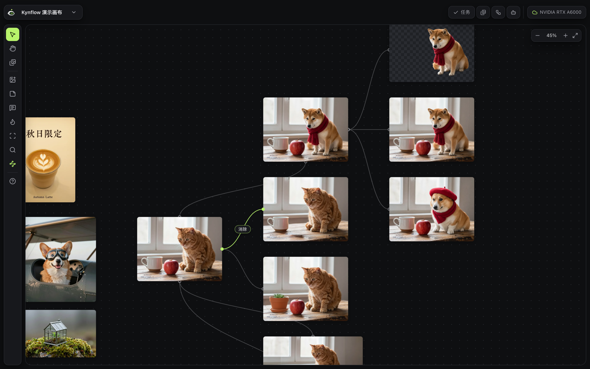
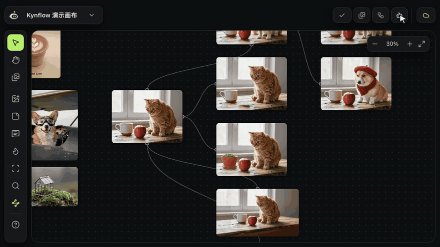

<div align="center">


# Kynflow

**An agent-driven infinite canvas for ComfyUI** — generate, edit and animate images, with every result linked back to its source

<a href="./README.md"></a>
<a href="./README.en.md"></a>



</div>

ComfyUI is powerful, but a node graph is a poor place to work while you look at results. Kynflow puts generation, editing and video on one infinite canvas: write a prompt at the bottom to generate, select an image to edit, extend, cut out, upscale or animate it. All generation runs on **your own ComfyUI** — local, on the LAN, or on a remote server through an automatic SSH tunnel. Kynflow only does the canvas: it does not include or distribute any models.

AI can drive it too. The **canvas assistant** in the top right reads the board, looks at images, generates, and can take a one-line idea all the way to a finished multi-shot short drama. **Claude Code** and **Codex** can operate the same board over MCP.

<div align="center"></div>

## Features

- **Infinite canvas**: pan, zoom, marquee select, drag, undo/redo, paste images, autosave, multiple boards, and it stays smooth with many nodes
- **Links are the workflow**: results connect back to their reference image, first frame or source; drag a line out of an image to generate the next step at the drop point
- **Built-in tools**: text-to-image, multi-reference editing, inpaint, erase, outpaint, background removal, SeedVR2 upscaling, image / text / first-last-frame / multi-reference video with native audio
- **25 official templates**: ready-made tools; each one reports which models are missing, where to download them and which folder they belong in, with one-click download
- **Import your own workflow**: drop in ComfyUI's **Export (API)** JSON; prompts, image inputs, seed and size are detected automatically
- **Canvas assistant**: reads the board, looks at images, generates images and video, runs your workflows, and links results the same way; it can take a short drama from script → shot list → character sheets → keyframes → video → final cut
- **Command palette (⌘K)**, **asset dock (⌘B)**, **series** (boards of one story share settings and memory) and **review** (pass or fail each result)
- **Chinese and English interface**: follows your browser's language, switchable in Settings

## Quick start

Requires Node.js 22.19+, a reachable ComfyUI and a desktop browser; cutting a final video also needs [ffmpeg](https://ffmpeg.org/).

```bash
git clone https://github.com/xingchen-mu/kynflow
cd kynflow
npm install
npm run dev
```

Open <http://localhost:5173>, click the ComfyUI status button in the top right to open **Settings**, enter your ComfyUI address (default `http://127.0.0.1:8188`), test it and save.

**Desktop app**

```bash
npm run desktop:dev    # run in a desktop window
npm run desktop:dist   # build an installer for the current platform
```

Installers are attached to [Releases](../../releases/latest).

## Connecting ComfyUI

| Where ComfyUI runs | How to connect |
|---|---|
| This machine | Default `http://127.0.0.1:8188` |
| LAN / server, reachable | Start ComfyUI with `--listen`, then use `http://server-ip:8188` in Settings |
| Server listening only on its own 127.0.0.1 | Set `SSH_HOST` in `.env`; `npm run dev` opens and keeps an SSH tunnel |

The backend listens on this machine only. To share it on the LAN, set `HOST=0.0.0.0` in `.env`; to serve it under another domain, add that name to `ALLOWED_HOSTS`. The backend has no authentication, so only do this on networks you trust — see [SECURITY.md](SECURITY.md).

## Canvas assistant

Open the **assistant** panel in the top right and set the model in **Settings → Assistant model** (model ID, OpenAI-compatible endpoint, API key). You can also use `.env` and restart:

```bash
DEEPSEEK_API_KEY=sk-...              # default deepseek/deepseek-flash, vision capable
# AGENT_BASE_URL=http://127.0.0.1:11434/v1
# AGENT_MODEL=qwen3:32b
# AGENT_API_KEY=...
```

It has to-do lists, questions with clickable choices, plan mode, rewind to an earlier message, long-term memory, `/` custom commands and automatic context compaction. API keys stay on your machine.

## Driving the canvas from Claude Code / Codex (MCP)

The backend ships an MCP server at `http://127.0.0.1:8787/mcp`, open to this machine only:

```bash
claude mcp add --transport http infinode http://127.0.0.1:8787/mcp
codex mcp add infinode --url http://127.0.0.1:8787/mcp
```

External agents get the same tools as the assistant — read the board, view images, generate images and video, cut a final video — and know which board and items you have selected in the page.

## Models and licenses

Kynflow itself is [MIT](LICENSE), free for personal and commercial use. **Model licenses are separate**, and the two models behind the built-in tools are restrictive:

- **Qwen-Image 2.1** (text-to-image / editing): research and evaluation only; commercial use needs a separate license
- **MiniMax H3** (video): commercial use allowed with attribution, but the license does not cover the US, the EU, the UK or South Korea

Turn on **"commercial-use models only"** in Settings to disable the rest. This is a summary only — always check each model's own license text.

## FAQ

- **First generation is slow?** The model loads from disk once, then stays in VRAM
- **Where is my data?** Everything is in `data/`; delete the folder to reset
- **Production?** `npm run build && npm start` — a single port, default `http://127.0.0.1:8787`
- **Website / live demo?** <https://xingchen-mu.github.io/kynflow/> — a static walkthrough that needs no GPU

Contributions are welcome: see [CONTRIBUTING.md](CONTRIBUTING.md). Templates come from ComfyUI's official templates (MIT); see [THIRD_PARTY_NOTICES.md](THIRD_PARTY_NOTICES.md). Kynflow is a community project and is not affiliated with Comfy Org. ComfyUI is a trademark of Comfy Org.
