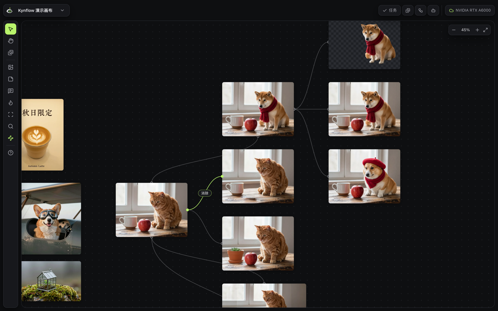
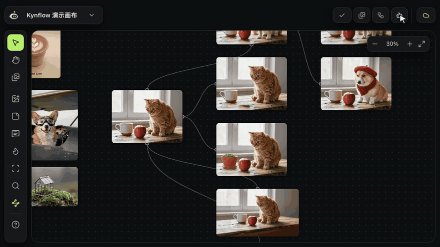

<div align="center">


# Kynflow

**Agent 驱动的 ComfyUI 无限画布** — 生图、改图、生视频，每个结果都连回它的来源

<a href="#中文"></a>
<a href="#english"></a>



</div>

## 中文

ComfyUI 很强，但节点图不适合"边看边改"。Kynflow 把生图、改图、生视频放进一块无限画布：底部写一句话出图，选中图片点一下就能改图、扩图、抠图、超清、生成视频。所有生成都在**你自己的 ComfyUI** 上完成（本机、局域网或远程 SSH 隧道）。Kynflow 只做画布，不包含也不分发任何模型。

也可以让 AI 来操作：右上角的**画布助手**能用一句话读画布、出图出视频，甚至从一句话做出一条多镜头短剧；**Claude Code / Codex** 可以通过 MCP 操作同一张画布。

<div align="center"></div>

### 功能

- **无限画布**：平移缩放、框选拖拽、撤销重做、粘贴图片、自动保存、多画布切换，节点多也不卡
- **连线即工作流**：结果自动连回它的参考图 / 首帧 / 原图；从图片右侧拉一条线，在终点生成下一步
- **内置工具**：文生图、多图参考编辑、局部重绘、消除、扩图、抠图、SeedVR2 超清、图生视频 / 文生视频 / 首尾帧 / 多图参考视频（自带声音）
- **25 个官方模板**：装好模型即用，缺什么模型、去哪下载、放哪个目录都写清楚，支持一键下载
- **导入自己的工作流**：把 ComfyUI「导出 (API)」的 JSON 拖进来，自动识别提示词、输入图、种子和尺寸
- **画布助手**：读画布、看图、出图出视频、运行你的工作流，结果照样连线；可从一句话做到多镜头短剧（剧本 → 分镜 → 设定图 → 关键帧 → 视频 → 成片）
- **命令面板 ⌘K**、**资产停靠栏 ⌘B**、**系列**（多画布共享设定与记忆）、**审阅**（逐张通过或打回）
- **中英文界面**：跟随浏览器语言，可在设置里切换

### 快速开始

需要 Node.js 22.19+、一个可访问的 ComfyUI、桌面浏览器；剪辑成片还需要 [ffmpeg](https://ffmpeg.org/)。

```bash
git clone https://github.com/xingchen-mu/kynflow
cd kynflow
npm install
npm run dev
```

打开 <http://localhost:5173>，点右上角的 ComfyUI 状态按钮进入**设置**，填入地址（本机默认 `http://127.0.0.1:8188`），测试通过后保存。

**桌面端**

```bash
npm run desktop:dev    # 本地窗口运行
npm run desktop:dist   # 打当前平台的安装包
```

安装包见 [Releases](../../releases/latest)。

### 连接 ComfyUI

| ComfyUI 在哪 | 怎么连 |
|---|---|
| 本机 | 默认 `http://127.0.0.1:8188` |
| 局域网 / 服务器 | ComfyUI 启动加 `--listen`，设置里填 `http://服务器IP:8188` |
| 服务器且只监听 127.0.0.1 | `.env` 填 `SSH_HOST`，`npm run dev` 会自动建立 SSH 隧道 |

后端默认只监听本机。想让局域网设备访问，在 `.env` 设 `HOST=0.0.0.0`；用其他域名访问则加进 `ALLOWED_HOSTS`。后端没有登录验证，只在你信任的网络里这样做，详见 [SECURITY.md](SECURITY.md)。

### 画布助手

右上角「助手」打开面板，在「设置 → 画布助手模型」填模型 ID、OpenAI 兼容地址和 API key；也可以写进根目录的 `.env` 后重启：

```bash
DEEPSEEK_API_KEY=sk-...              # 默认 deepseek/deepseek-flash，能看图
# AGENT_BASE_URL=http://127.0.0.1:11434/v1
# AGENT_MODEL=qwen3:32b
# AGENT_API_KEY=...
```

支持待办清单、提问、计划模式、回退到某一步、长期记忆、`/` 自定义命令和上下文自动整理。API key 只保存在本机。

### 用 Claude Code / Codex 操作画布（MCP）

后端自带 MCP 服务 `http://127.0.0.1:8787/mcp`，只对本机开放：

```bash
claude mcp add --transport http infinode http://127.0.0.1:8787/mcp
codex mcp add infinode --url http://127.0.0.1:8787/mcp
```

外部 agent 能用和画布助手同一套工具读画布、看图、出图出视频、剪辑成片，并知道你在页面上选中了什么。

### 模型与许可证

Kynflow 本身是 [MIT](LICENSE)，个人和公司都可自由使用，包括商用。**模型另有许可证**，内置工具用到的两个限制较多：

- **Qwen-Image 2.1**（文生图 / 改图）：仅限研究和评估，商用需另行授权
- **MiniMax H3**（视频）：可商用但需标注来源，且许可证不覆盖美国、欧盟、英国和韩国

需要商用可以在设置里打开「只用可以商用的模型」。以上仅供参考，以各模型页面原文为准。

### 常见问题

- **首次生成很慢？** 模型第一次要从硬盘加载，之后在显存里就快了
- **数据存在哪？** 全部在 `data/`，删掉整个目录即可清空
- **生产部署？** `npm run build && npm start`，单端口，默认 `http://127.0.0.1:8787`
- **官网 / 在线演示？** <https://xingchen-mu.github.io/kynflow/>（静态演示，不占 GPU）

欢迎参与贡献，见 [CONTRIBUTING.md](CONTRIBUTING.md)。模板来自 ComfyUI 官方模板（MIT），见 [THIRD_PARTY_NOTICES.md](THIRD_PARTY_NOTICES.md)。Kynflow 是社区项目，与 Comfy Org 没有关联；ComfyUI 是 Comfy Org 的商标。

---

## English

<div align="center">

<a href="#中文"></a>
<a href="#english"></a>

</div>

**Kynflow** is an infinite canvas for ComfyUI. Write a prompt to generate, select an image to edit, extend, cut out, upscale or animate it, and every result stays linked to the inputs it came from. All generation runs on **your own ComfyUI** (local, LAN or remote over an automatic SSH tunnel). Kynflow only does the canvas: it does not include or distribute any models.

A built-in **canvas assistant** can read the board, look at images, generate, run your workflows and even take a one-line idea to a finished multi-shot short drama. **Claude Code** and **Codex** can drive the same board over MCP.

### Features

- **Infinite canvas**: pan, zoom, marquee select, undo/redo, paste images, autosave, multiple boards
- **Links are the workflow**: results connect back to their reference image, first frame or source; drag a line out of an image to place the next step
- **Built-in tools**: text-to-image, multi-reference editing, inpaint, erase, outpaint, background removal, SeedVR2 upscaling, image / text / first-last-frame / reference-to-video with native audio
- **25 official templates**: ready-made tools with per-template model checks, download links and target folders
- **Import your own workflow**: drop in ComfyUI's **Export (API)** JSON; prompts, inputs, seed and size are detected
- **Command palette (⌘K)**, **asset dock (⌘B)**, **series** (boards of one story share settings and memory) and **review** (pass or fail each result)
- **Chinese and English interface**: follows your browser, switchable in Settings

### Quick start

Requires Node.js 22.19+, a reachable ComfyUI and a desktop browser; cutting a final video also needs [ffmpeg](https://ffmpeg.org/).

```bash
git clone https://github.com/xingchen-mu/kynflow
cd kynflow
npm install
npm run dev
```

Open <http://localhost:5173>, open **Settings** from the ComfyUI status button, enter your ComfyUI address (default `http://127.0.0.1:8188`) and save.

**Desktop app**

```bash
npm run desktop:dev    # run in a desktop window
npm run desktop:dist   # build an installer for the current platform
```

Installers are attached to [Releases](../../releases/latest).

### Assistant and MCP

Set the model in **Settings → Assistant model** (model ID, OpenAI-compatible endpoint, API key), or use `.env`:

```bash
DEEPSEEK_API_KEY=sk-...              # default deepseek/deepseek-flash, vision capable
# AGENT_BASE_URL=http://127.0.0.1:11434/v1
# AGENT_MODEL=qwen3:32b
# AGENT_API_KEY=...
```

The MCP server at `http://127.0.0.1:8787/mcp` is open to this machine only:

```bash
claude mcp add --transport http infinode http://127.0.0.1:8787/mcp
codex mcp add infinode --url http://127.0.0.1:8787/mcp
```

### Models and licenses

Kynflow itself is [MIT](LICENSE), free for personal and commercial use. **Model licenses are separate**, and the two built-in ones are restrictive:

- **Qwen-Image 2.1** (text-to-image / editing): research and evaluation only; commercial use needs a separate license
- **MiniMax H3** (video): commercial use allowed with attribution, but the license does not cover the US, the EU, the UK or South Korea

Turn on **"commercial-use models only"** in Settings to disable the rest. Always check each model's own license.

### FAQ

- **First generation is slow**: the model loads from disk once, then stays in VRAM
- **Where is my data?** Everything is in `data/`; delete the folder to reset
- **Production**: `npm run build && npm start` (single port, default 8787)
- **Website / live demo**: <https://xingchen-mu.github.io/kynflow/> (static, no GPU)

See [CONTRIBUTING.md](CONTRIBUTING.md) to contribute and [THIRD_PARTY_NOTICES.md](THIRD_PARTY_NOTICES.md) for template credits. Kynflow is a community project, not affiliated with Comfy Org. ComfyUI is a trademark of Comfy Org.
