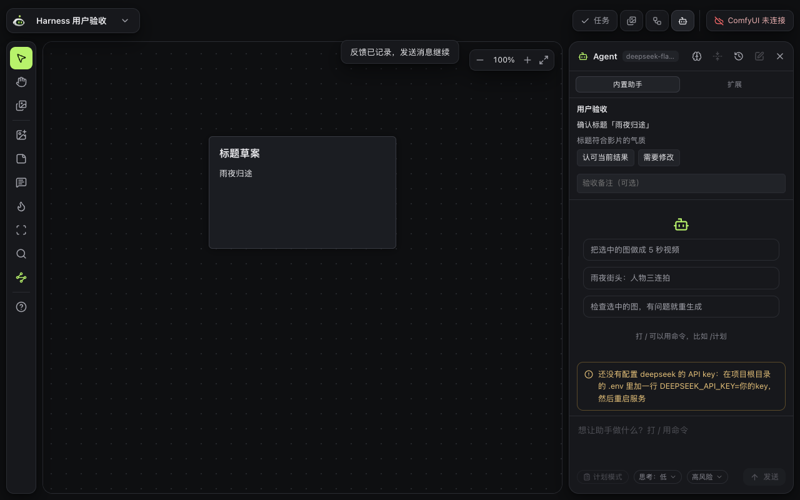

# Agent Harness 基础设施

这轮按可靠性、上下文与工具、验证与反馈、评估四阶段完善现有模块。Pi Agent Core 保持原样；没有扩展新的图片或视频专用能力。简单生成仍可直接执行，不强制建立 DAG。

## 四阶段交付

| 阶段 | 计划项 | 实现与验证入口 |
| --- | --- | --- |
| 可靠性 | Run / Task / Session 生命周期 | `runtime/run-controller.ts`；模型循环、GPU 执行、会话分别管理，停止与切换等待在途确认结束 |
| 可靠性 | Task Graph 状态机 | `task-graph.ts`；程序校验依赖、revision、尝试次数、完成门禁 |
| 可靠性 | 生成幂等与重复提交 | `runtime/submissions.ts`；任务尝试/批次成员身份，原生 TaskManager 持久化去重 |
| 可靠性 | 恢复与取消 | POST 前持久化 promptId；查原队列/历史，不盲目重发；中断图任务可重新关联原输出 |
| 可靠性 | 统一错误 | `tool-errors.ts`；code、retryable、recovery 回到模型上下文与 Trace |
| 可靠性 | 统一执行预算 | 模型、工具、生成、Token、时间、可选费用限制；会话生成预留持久化 |
| 上下文与工具 | Context Provider | `context-builder.ts`；可替换来源、优先级、完整块、来源版本与去重 |
| 上下文与工具 | Token Budget | 预留系统、工具、历史、图片、输出；必要块放不下则明确失败 |
| 上下文与工具 | 任务相关资产 | 当前任务/依赖/选择/一层素材来源检索；必要输入完整索引，长文本相关摘录 |
| 上下文与工具 | 工具治理 | `tool-policy.ts`；能力目录、读写类别、现有审批策略、协作式超时；所有生成仍经过统一提交边界 |
| 上下文与工具 | 技能动态匹配 | `skills.ts`；确定性词项匹配、必要工具过滤、最多三项组合、内容版本、任务级激活及按需资源读取 |
| 验证与反馈 | Validator 接口 | `verification.ts`；注册可替换的验证器，不把所有条件交给 VLM |
| 验证与反馈 | pass / fail / unknown | 结构、文件、媒体、视觉与用户验证；证据不足或验证异常返回 unknown |
| 验证与反馈 | 任务验收绑定 | 完成前重新验证；签名绑定任务、尝试、目标、条件、输入和输出版本 |
| 验证与反馈 | 自动候选经验 | complete/fail 后提取实际工具和输出、模型、执行图指纹、适用条件与验证来源；确定性验收可标为 machine-verified |
| 验证与反馈 | 用户反馈闭环 | Agent 面板可认可或要求修改；本机 API 验证会话、revision、输出签名；Run 反馈可提升对应候选经验 |
| 评估与优化 | Mock 工具环境 | 真实 HTTP、上传、TaskManager、排队和资产落盘；超分/编辑的返回尺寸符合请求协议 |
| 评估与优化 | Agent Benchmark | 固定二十场景，脚本/真实模型两种模式；场景、协议、源码与提示版本记入报告 |
| 评估与优化 | 成功率与资源 | 保留 Token、模型/工具调用、重试、提交数、时间、反馈；blocked 不算成功 |
| 评估与优化 | 配置消融 | baseline/enhanced；另外支持同一工具集的 `--context focused/providers` 对照 |
| 评估与优化 | 按瓶颈扩展 | 本轮先检验运行可靠性与上下文开销；没有足以支持新视觉领域模块的质量增益证据 |

## 生命周期与执行边界

Run 是一次模型与工具循环；Task 是跨多个 Run、具有依赖和验收条件的目标；Session 保存对话、任务图、技能激活与累计生成预留。Run 结束并不把 GPU Task 标为完成。

Agent 的所有生成工具，包括批次成员和延迟确认，都通过 AsyncLocalStorage 提交范围。原生任务保存 project/session/run、图任务及尝试编号和 operationKey。图任务同一尝试的同一批次成员只复用原提交；参数不符会报错。开始另一次尝试前也检查同一图任务是否仍有在途 GPU 工作。

TaskManager 在 POST `/prompt` **之前**保存 promptId、执行图指纹和 prepared 状态。响应丢失时保存 uncertain 状态，恢复通过该 ID 查询队列和历史。未确认窗口为五分钟；到期仍找不到会报告失败，需要人工检查后决定重试。这不是与远端 ComfyUI 的分布式事务，也不保证记录被清理后的永久 exactly-once。

停止会中止本次模型/工具的后续提交，并移除自动唤醒；已经接受的远程 GPU 工作仍保留，可以明确取消。图任务在应用恢复时能够重新关联已拥有的任务与画布输出；没有旧归属信息的历史工作不会被猜测为当前会话的工作。非图任务在提交和画布绑定之间崩溃时，原生任务记录仍可查询，但不自动重建用户可能已删除的画布节点。

输入/输出内容身份使用不可变资产 ID 或文本内容哈希；位置和名称变化不会使任务失效。上游内容改变会使相关任务与下游验收失效。旧 GPU 输出保留供排查，不自动重新生成。生成与确认开始前再次同步任务状态；已经在远端执行的旧版本由后续失效检查阻止验收。

JSON 写入按文件排队，使用独立临时文件与 rename 原子替换。任务、画布、Trace、经验仍是不同文件，没有跨文件事务；幂等身份和恢复逻辑处理这些提交间隙。

## 默认预算

| 环境变量 | 默认 | 范围 |
| --- | ---: | --- |
| `AGENT_RUN_MAX_TOOLS` | 160 | 一次 Run 的工具尝试 |
| `AGENT_RUN_MAX_MODELS` | 80 | 主模型、Critic、摘要调用合计 |
| `AGENT_RUN_MAX_TOKENS` | 2000000 | 输入、缓存读写与输出合计 |
| `AGENT_RUN_MAX_GENERATIONS` | 32 | 一次 Run 的生成预留，按批次成员计 |
| `AGENT_RUN_TIMEOUT_MS` | 1800000 | Run 时间预算 |
| `AGENT_SESSION_MAX_GENERATIONS` | 128 | 持久化的会话生成预留 |

非负整数可覆盖默认值，0 表示不允许消耗该资源。失败的预留也计数，避免通过失败循环绕过限制。显式新请求开启新 Run；新会话重置会话预算；摘要、截断日志和重启不会重置当前会话预算。它们是提交/资源计数，不是 GPU 计费记录。

Token 使用量由响应报告，所以单个在途请求可能超过剩余额度，后续请求被阻止；这不是供应商端硬性费用封顶。自定义端点没有价格时费用可能为零。工具超时通过 AbortSignal 协作取消，不使用 Promise.race 提前释放仍在写入的操作。

## 上下文与技能

Provider 返回带 source、version、content、tokenCount、relevance、required 的完整块。任务、资产、技能、经验和检索记忆分别排序；Pi 的历史原样保留并预留预算，系统提示已有的固定记忆也计入预留。这里没有再次注入完整历史。

当前估算器为 `utf8-bytes-v1`，文本采用保守字节估算，图片每张预留 4096，输出默认预留最多 8192；它不是供应商 tokenizer 或精确计费器。附加检索上下文上限为 18000 估算 Token。必要任务目标、所有硬条件和输入索引不能通过普通截断丢弃。预算不足时需要整理历史或缩小范围。Trace 记录采用/省略来源及版本，实际响应使用量单独记录。

技能匹配是可解释的词项排序，不宣称语义理解能力。无任务时手动读取的技能可作为会话默认；任务内激活只服务对应任务。最多组合三项，缺少必要工具时拒绝激活；技能无法授予权限。SKILL 元数据和正文内容计算版本，真正注入的来源块也带内容版本。参考文件继续沿用目录、符号链接和大小限制，并按需读取。

## 验证与人类反馈

AcceptanceCriterion 可使用 `validator.kind`：

- `asset`：输出存在且文件可读。
- `schema`：文本 JSON 通过有界 Schema 子集；不支持的关键字返回 unknown。支持 type/properties/required/items/enum/additionalProperties、长度/数量与数值上下界，不解析远程引用或执行正则表达式。
- `media`：minWidth/minHeight/aspect/minDuration/maxDuration；缺失元数据返回 unknown，不猜测时长。
- `user`：本机用户对当前版本明确认可。

有 dimension 的条件仍走独立视觉审查。缺少/范围不符/看不清的证据映射为 unknown；观察到的缺陷为 fail。稀疏视频帧不能证明全片时序。unknown 阻止完成，需要补充证据或请求用户判断，不自动消耗一次生成尝试。

`validate_task` 返回逐项证据。complete 在真实文件及当前素材上重新验证；Agent 不能通过工具参数注入验证结果。旧的纯描述性条件继续兼容原逐条 evidence 机制，并检查输出可读，但不会因此宣称主观语义已由机器证明。

用户可在面板点击“认可当前结果”或“需要修改”，可附备注，再发送消息让助手继续。HTTP 入口是 `POST /api/agent/:projectId/tasks/:taskId/feedback`，需要 sessionId、revision、criterionId、signature、verdict、note。signature 从当前 AgentView/task-graph 获取，素材在打开面板后被替换时旧反馈会被拒绝。运行中的按钮禁用，已通过后的反向反馈会使已完成任务及依赖验收失效。Agent 没有调用此用户入口的工具。

自动经验保留 run/task/attempt、模型标识、可用时的实际执行图 SHA256、验收结果与适用条件。执行图指纹包含实际参数，不是工作流语义版本号。检索可按模型/执行图过滤。自动条目分为 agent-inferred 与 machine-verified；机器验证只证明所列规格，不代表审美质量。只有用户确认 API 或同一 Run 的明确反馈能标为 user-confirmed。路由质量估计仍只使用用户确认的经验。



## 验证与复现

```sh
npm test
npm run build
npm run smoke
npm run eval:agent
npm run benchmark:agent -- --mode scripted --profile both --output output/harness-benchmark.json
npm run benchmark:agent -- --mode scripted --profile enhanced --context focused --output output/harness-focused.json
npm run benchmark:agent -- --mode scripted --profile enhanced --context providers --output output/harness-providers.json
# 单独的真实 GPU 执行恢复验证，仅提交一个图像任务，要求队列空闲：
npm run smoke:agent:recovery -- --real-gpu
```

本轮本地全量测试 309 项通过，覆盖中断/重启、失去提交确认、同一尝试去重、上传中取消、迟到事件归属、预算、内容失效、技能能力缺失、上下文压力、unknown 验证、旧签名拒绝和用户反馈。构建与离线生产启动通过。浏览器使用 Playwright CLI + 本机 Chrome（Browser 插件未提供），验证 1280×800 面板、点击后的持久化 pass、成功反馈提示，控制台 0 error / 0 warning。

真实执行恢复记录：2026-11-25，ComfyUI 0.41.2，NVIDIA RTX A6000，Z-Image，seed 42，1024×1024；关闭并重新建立客户端和 TaskManager 后复用同一 promptId，queueCalls=1，最终 done。首次执行已取回图片，但报告器不接受设备名称中的冒号；修复后完整复测通过。原始本地报告在 `output/harness-recovery/report.json`。

Mock 协议 v3 返回尺寸正确的占位图，并加强超分/比例/分辨率检查。16:9 编辑允许既有工作流的 32 像素网格量化；同时必须提交 16:9 参数，不能用宽松比例检查代替正确参数。此前占位图尺寸导致的真实模型失败继续保留在旧实验记录中，不能以新协议结果改写旧结论。

脚本 Benchmark 的决策固定，只验证协议与资源开销；没有 GPU，也没有生成审美评分。真实模型 Benchmark 仍可用 `--mode live` 运行，需要独立配置有效 API；本轮没有重新执行真实 LLM 质量对照，不据此声称推理能力或视觉质量提升。相关证据与开销见 [结果记录](harness-foundation-results.md)。
